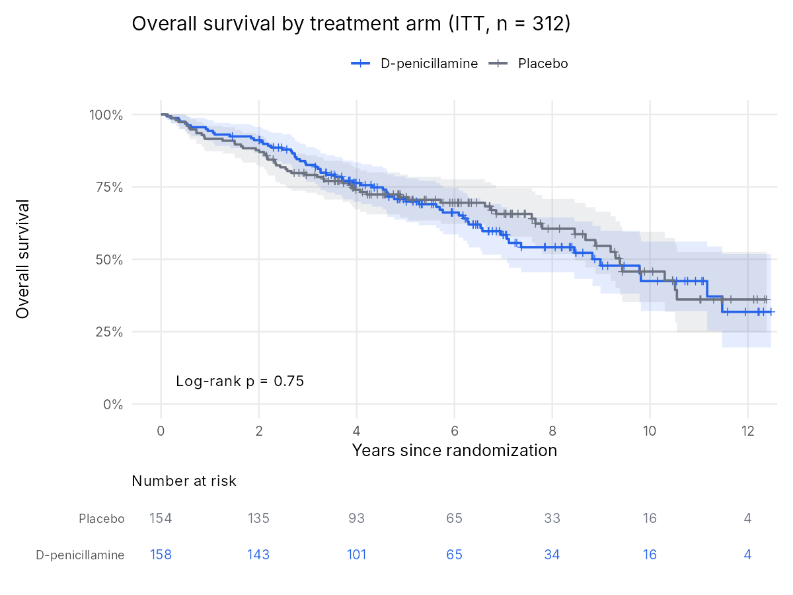
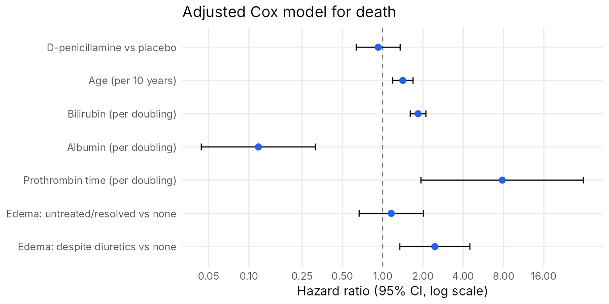
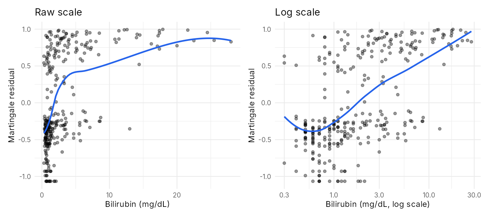
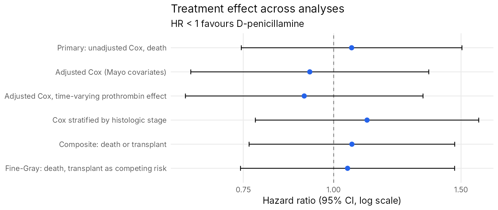
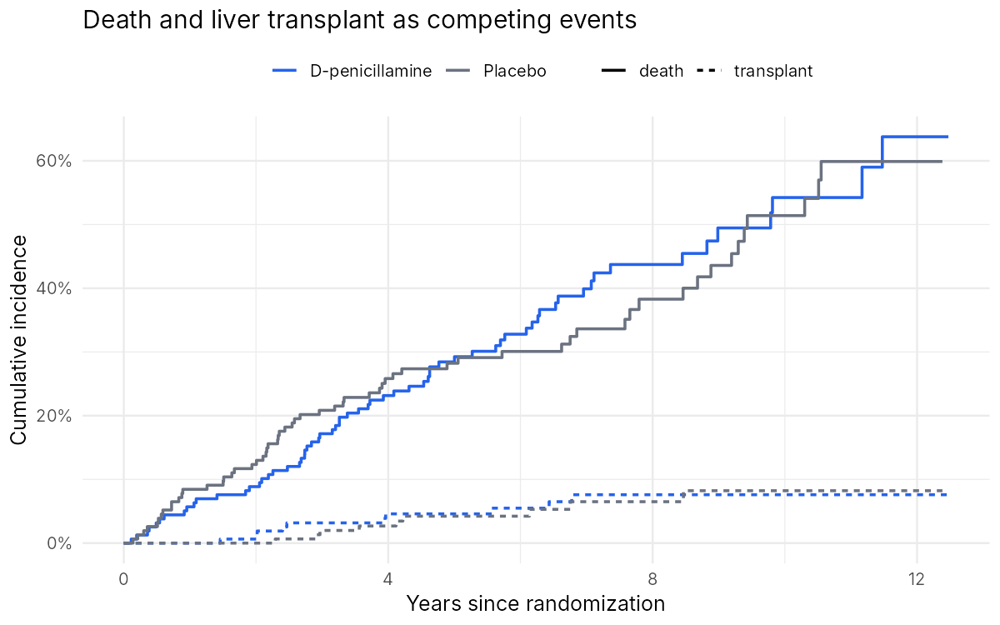
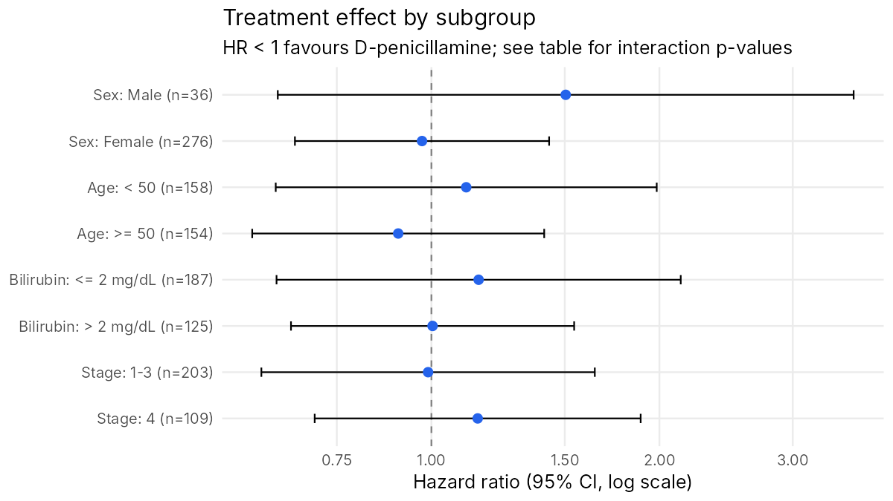

# Survival Analysis of a Randomized Clinical Trial: D-penicillamine in PBC

A complete, reproducible re-analysis of the Mayo Clinic placebo-controlled trial of D-penicillamine for primary biliary cholangitis (PBC), following a pre-specified [Statistical Analysis Plan](SAP.md) the way a trial would be analysed in industry or an academic medical center.

**Skills shown:** SAP writing · Table 1 with standardized differences · Kaplan–Meier and log-rank · Cox regression · proportional-hazards and functional-form diagnostics · competing risks (Aalen–Johansen, Fine–Gray) · RMST · subgroup analysis with interaction tests · power calculation · reproducible R with unit tests

## Key findings

- **No survival benefit from D-penicillamine.** 125 of 312 patients died. Median survival was 9.0 years on D-penicillamine vs 9.4 years on placebo (log-rank p = 0.75).
- **The null result is robust.** The hazard ratio stays close to 1 in every analysis: unadjusted HR 1.06 (95% CI 0.75–1.50), adjusted HR 0.93 (0.64–1.35), Fine–Gray HR 1.05 (0.74–1.47). The 10-year RMST difference is −0.14 years (−0.94 to 0.67).
- **Disease severity, not treatment, drives survival.** Each doubling of bilirubin raises the hazard of death by 84% (HR 1.84, 1.61–2.11), and edema despite diuretics more than doubles it (HR 2.45).
- **The trial could only rule out large effects.** With 125 deaths it had 82% power for HR = 0.6 but only 36% for HR = 0.75, so a modest benefit cannot be excluded.



## Analysis walk-through

### 1. Baseline characteristics
Randomization produced well-balanced arms ([full Table 1](output/tables/table1_baseline.md)). The largest imbalances were age (SMD 0.27; D-penicillamine patients about 3 years older) and histologic stage (SMD 0.25). Both are prognostic, which is one reason the adjusted and stage-stratified analyses below are included.

### 2. Primary analysis

| Arm | Deaths / N | Median survival (years) | 5-year survival | 10-year survival |
|---|---|---|---|---|
| Placebo | 60 / 154 | 9.4 | 71.5% (64.5–79.2) | 45.7% (35.2–59.5) |
| D-penicillamine | 65 / 158 | 9.0 | 70.8% (63.7–78.6) | 42.5% (32.2–56.1) |

Log-rank χ² = 0.10, df = 1, p = 0.75.

### 3. Adjusted Cox model
Covariates are those of the Mayo PBC risk score, with lab values on a log2 scale so each HR reads as "per doubling".



### 4. Checking the model's assumptions
**Functional form.** Martingale residuals curve sharply against raw bilirubin but are close to linear against log bilirubin. The log form also fits better (AIC 1148.8 vs 1197.3).



**Proportional hazards.** The global Schoenfeld test is not significant (p = 0.083). The treatment effect shows no departure from PH (p = 0.39). Prothrombin time does (p = 0.026): its effect is strongest early in follow-up. Refitting with a time-varying prothrombin coefficient leaves the treatment HR essentially unchanged (0.91 vs 0.93). [Residual plots](output/figures/schoenfeld_residuals.png).

### 5. Sensitivity analyses



Liver transplant is a competing event: a transplanted patient can no longer be observed to die of PBC. Transplants were rare (about 8% by 10 years in both arms), so treating them as censoring, as a composite event, or as a competing risk gives the same answer.



### 6. Subgroups
No subgroup shows evidence of a different treatment effect (all interaction p > 0.3). The male subgroup is small (n = 36), hence its wide interval. [Table](output/tables/subgroup_hr.md).



### 7. What could this trial detect?

| True HR | Power with 125 deaths | Deaths needed for 80% power |
|---|---|---|
| 0.50 | 97% | 66 |
| 0.60 | 82% | 121 |
| 0.70 | 51% | 247 |
| 0.75 | 36% | 380 |

A "negative" trial is only as informative as its power. This one convincingly rules out a large benefit, but it was too small to detect a 25% reduction in hazard.

## Limitations
- Single-center trial from 1974–1984; PBC treatment today (ursodeoxycholic acid) is different.
- Subgroup analyses are exploratory, with no multiplicity adjustment.
- The adjusted model uses complete covariate data, so no imputation was needed; in a modern trial, missing-data handling would be pre-specified.

## Reproduce

Requires R ≥ 4.1 with `survival`, `dplyr`, `ggplot2`, `patchwork`, `knitr`, `scales` and `testthat`.

```bash
cd 01-clinical-trial-survival
Rscript run_all.R                          # writes output/tables and output/figures
Rscript -e 'testthat::test_dir("tests")'   # unit tests
```

```
01-clinical-trial-survival/
├── SAP.md                 statistical analysis plan
├── run_all.R              runs the full analysis
├── R/functions.R          data prep, Table 1, KM, Cox, RMST, competing risks, plots
├── tests/                 testthat unit tests
└── output/
    ├── tables/            every table as .csv and .md
    ├── figures/           every figure as .png
    └── sessionInfo.txt    package versions used
```

**Data source:** Therneau T, Grambsch P. *Modeling Survival Data: Extending the Cox Model.* Springer, 2000. Distributed as `pbc` in the R `survival` package.
