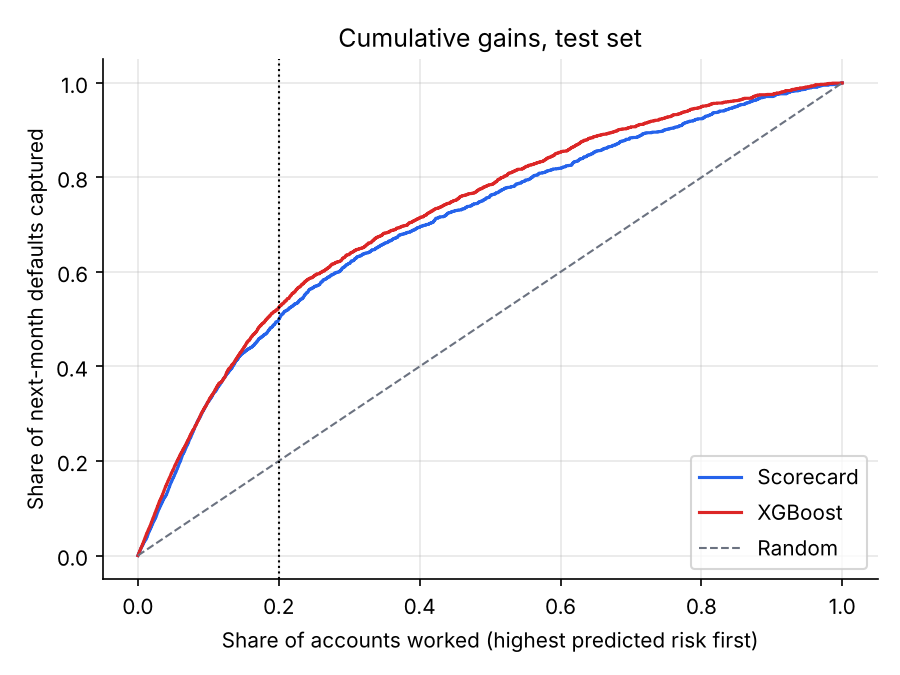
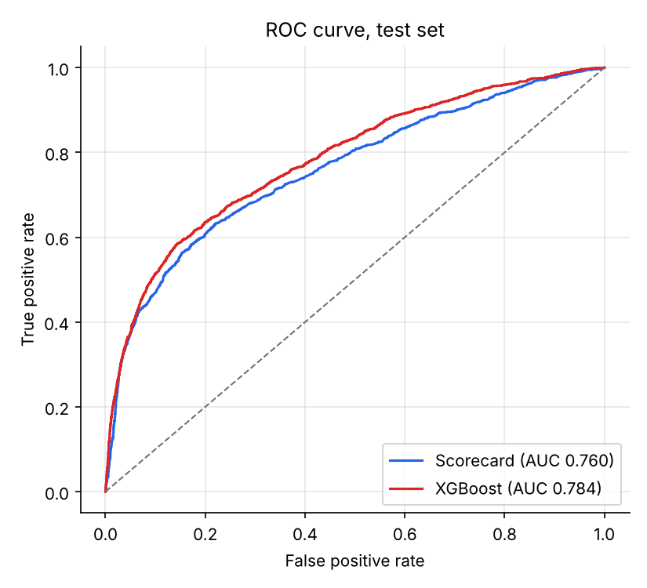
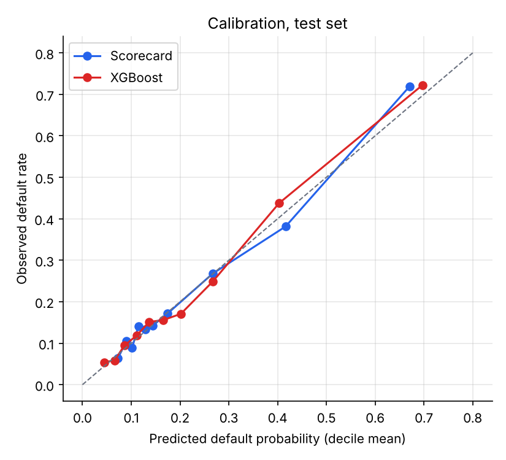
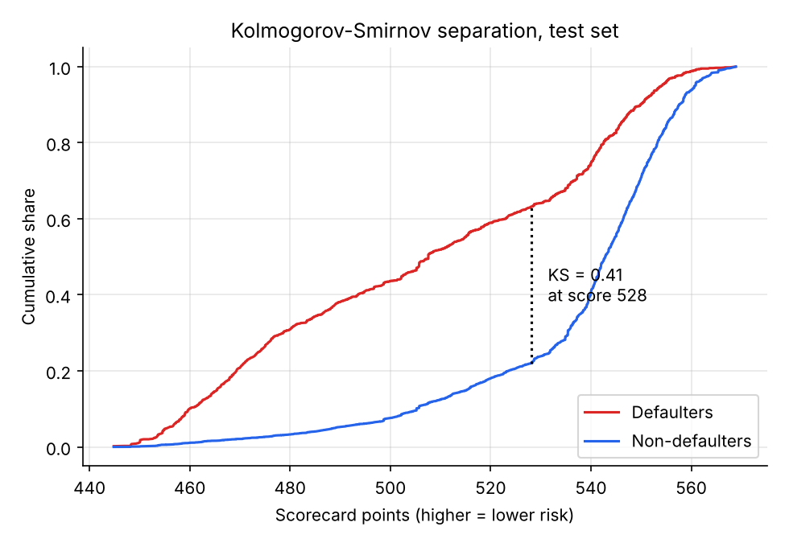
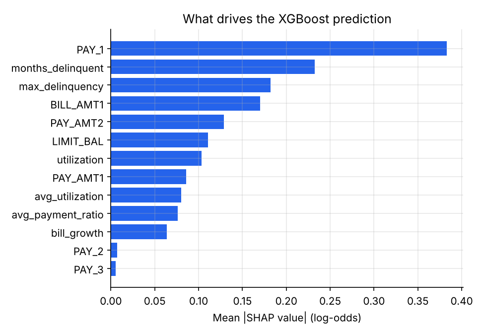

# Credit Card Default Risk: Scorecard vs. Gradient Boosting

Which credit card customers will miss next month's payment, and how should a bank use that prediction? This project builds the two kinds of model a card issuer's risk team would compare: a **points-based scorecard** (interpretable, the industry standard for regulated decisions) and an **XGBoost challenger**. Both are validated the way a model risk team would validate them, then turned into a collections strategy.

**Skills shown:** weight-of-evidence binning and information value · logistic regression scorecard with points scaling · XGBoost with cross-validated tuning · AUC, Gini, KS, Brier, calibration · population stability index · SHAP explanations · fair-lending check (adverse impact ratio) · translating model output into a business decision · tested, reproducible Python

## Key findings

- **The challenger wins, but not by much.** On held-out data XGBoost reaches AUC 0.784 (Gini 0.57, KS 0.44) against the scorecard's 0.760 (Gini 0.52, KS 0.41). A bank would need to weigh 2.4 AUC points against losing a model that fits on one page and gives every declined customer a reason code.
- **Recent payment behaviour dominates.** Last month's repayment status alone has an information value of 0.85. Customers more than one month late default at 69%, against 14% for customers who are current.
- **The model makes collections far more efficient.** Working the riskiest 20% of accounts reaches half of next month's defaulters and over 50% of the expected loss, 2.5 times what a random 20% would. In the riskiest 10%, more than 7 in 10 accounts flagged do default.
- **Both models are stable and fair on the checks run here.** Train/test PSI is 0.002 (below 0.1 is considered stable). Adverse impact ratios by sex and by age band are all above 0.95, comfortably clear of the 0.8 four-fifths threshold.



## Data

30,000 credit card holders at a Taiwanese bank, observed April–September 2005 ([UCI repository](https://archive.ics.uci.edu/dataset/350/default+of+credit+card+clients); Yeh & Lien, 2009). This project uses the 24,000-row modelling sample distributed with PyCaret ([details](data/README.md)). The default rate is 22.1%, the same as in the full data.

Each row has the credit limit, six months of repayment status, statement balances and payments, and demographics. The target is default on the October 2005 payment.

**Cleaning.** Undocumented codes (education 0/5/6, marital status 0) are folded into "other". Repayment codes −2 (no balance) and −1 (paid in full) both mean "not late" and are set to 0.

**Features.** Alongside the raw fields, I added behavioural features of the kind used in card scorecards: months delinquent in the last six, worst delinquency, utilisation (balance / limit), average share of each bill that was paid, and balance growth.

**Fair lending.** Sex, marital status and age are protected characteristics under the US Equal Credit Opportunity Act, so they are **never used as features**; they are kept only to test the model for disparate impact. Education is also excluded as a likely proxy.

## Method

Stratified 70/30 train/test split (16,800 / 7,200 accounts). Everything is fitted on train; the test set is used once, for the numbers below.

### 1. Scorecard

1. **Binning.** Each numeric feature is cut into up to 6 quantile bins, each holding at least 5% of accounts, then adjacent bins are merged until the default rate moves in one direction only. Monotonic bins keep the scorecard explainable ("a higher limit never costs you points").
2. **Weight of evidence and information value.** Each bin is replaced by its WOE, ln(% of goods / % of bads), and features are ranked by IV.
3. **Selection.** I kept features with IV ≥ 0.02, then dropped one of any pair with WOE correlation above 0.7. Any feature whose coefficient came out with the wrong sign was also dropped, because that is a symptom of collinearity. Ten features remain ([selection log](output/tables/feature_selection.md)).
4. **Points.** Logistic regression on the WOE features, scaled so that 600 points means good:bad odds of 50:1 and every 20 points doubles the odds ([full scorecard](output/tables/scorecard_points.md)).

| Feature | Bin | Default rate | Points |
|---|---|---|---|
| Last month's repayment status | current | 14% | 63 |
| | 1 month late | 34% | 41 |
| | 2+ months late | 69% | 15 |
| Worst delinquency, last 6 months | never late | 12% | 59 |
| | 2+ months | 46% | 42 |

### 2. XGBoost challenger
Gradient-boosted trees on the same 13 candidate features, tuned with 5-fold cross-validated grid search over depth, number of trees and minimum child weight. The best setting was depth 3, 200 trees (CV AUC 0.781).

## Validation

| Model | Sample | AUC | Gini | KS | Brier |
|---|---|---|---|---|---|
| Scorecard | train | 0.765 | 0.529 | 0.408 | 0.138 |
| Scorecard | **test** | **0.760** | **0.519** | **0.412** | **0.137** |
| XGBoost | train | 0.802 | 0.603 | 0.451 | 0.130 |
| XGBoost | **test** | **0.784** | **0.567** | **0.441** | **0.132** |

The scorecard loses almost nothing between train and test. XGBoost loses about 2 AUC points, a mild sign of overfitting that is normal for boosted trees.

<p>


</p>

Both models are **well calibrated**: within each decile, the predicted default probability is close to the observed rate. That matters because the predicted probabilities feed expected-loss and provisioning calculations, not only rankings.



**Explainability.** SHAP values show that XGBoost relies on the same signals as the scorecard: last month's repayment status first, then delinquency history and balance.



## Business use: prioritising collections

Suppose the collections team can contact a fixed share of customers before the payment date. Exposure at default is the current balance, and I assume 75% of it is lost on default.

| Accounts worked | Model | Defaulters reached | Expected loss reached | Share of contacted who default |
|---|---|---|---|---|
| 10% | Scorecard | 33% | 37% | 72% |
| 10% | XGBoost | 33% | 43% | 72% |
| 20% | Scorecard | 50% | 54% | 55% |
| 20% | XGBoost | 52% | 56% | 58% |
| 20% | Random | 20% | 20% | 22% |

**Recommendation.** Use the scorecard for decisions that need a reason code, such as credit-line decreases. Use XGBoost's ranking to order the collections queue: there it reaches 6 points more of the expected loss in the top 10%, and the queue order needs no adverse-action notice.

## Fair-lending check

The riskiest 20% under the scorecard are flagged. A group's adverse impact ratio is its share *not* flagged divided by that of the most favoured group in the same attribute.

| Group | Flagged | Actual default rate | Adverse impact ratio |
|---|---|---|---|
| Female | 19.4% | 20.9% | 1.00 |
| Male | 21.5% | 23.9% | 0.97 |
| Age < 30 | 22.1% | 22.6% | 0.96 |
| Age 30–44 | 18.4% | 20.3% | 1.00 |
| Age 45+ | 21.4% | 26.3% | 0.96 |

Every ratio is well above 0.8. Each group is flagged at a rate close to its actual default rate.

## Limitations
- **No out-of-time test.** All accounts come from the same six months. A production model would also be validated on a later period, and PSI would be monitored month by month.
- **Single-month horizon.** Regulatory PD models (CECL, IFRS 9, Basel) predict default over 12 months or a lifetime. This dataset supports only next-month default.
- **Loss assumptions.** The 75% loss rate and balance-as-exposure are simplifications; recoveries and the timing of losses are ignored.
- **Taiwan, 2005.** The data come from the tail of Taiwan's 2005–06 card-debt crisis, so the default rate is far above that of today's US card portfolios.

## Reproduce

```bash
cd 02-credit-risk-scorecard
pip install -r requirements.txt
python run_all.py      # writes output/tables and output/figures (about 15 s)
pytest -q tests        # 9 unit tests
```

```
02-credit-risk-scorecard/
├── run_all.py          full pipeline: split, scorecard, XGBoost, validation, business and fairness analysis
├── src/
│   ├── data.py         loading, cleaning, feature engineering
│   ├── woe.py          monotonic WOE binning, IV, scorecard points
│   └── metrics.py      KS, Gini, PSI, decile and calibration tables
├── tests/              pytest unit tests (incl. a check that points reproduce the model's log-odds)
├── data/               source data and provenance
└── output/             every table (.csv/.md) and figure (.png)
```
