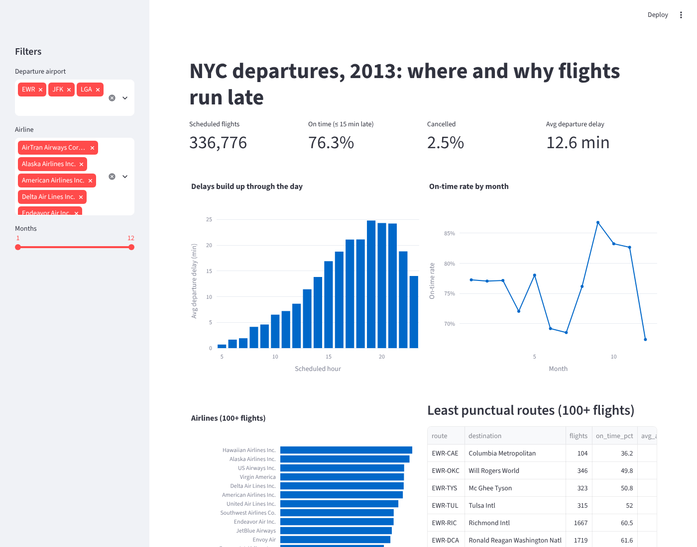
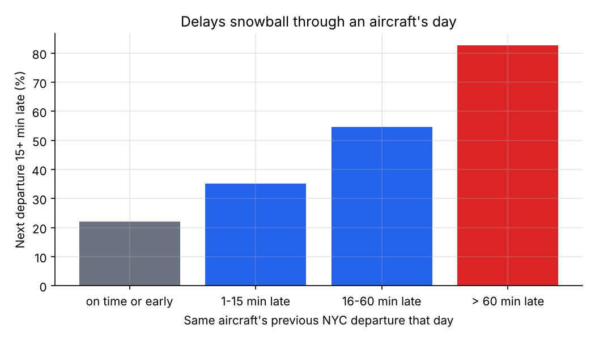
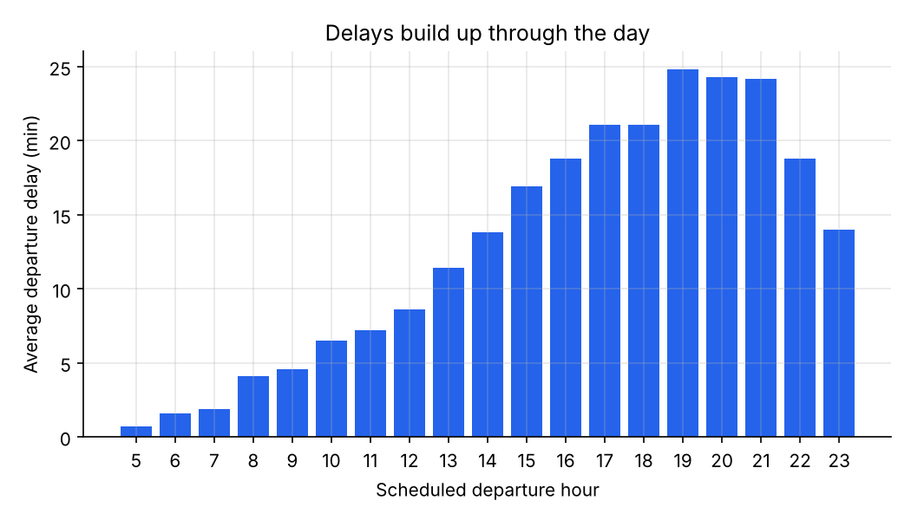
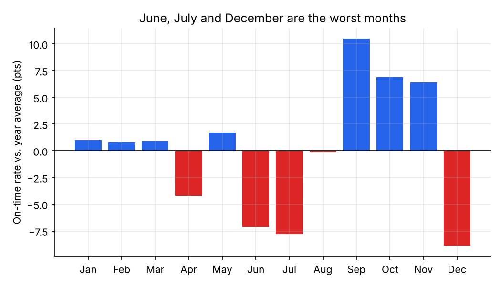
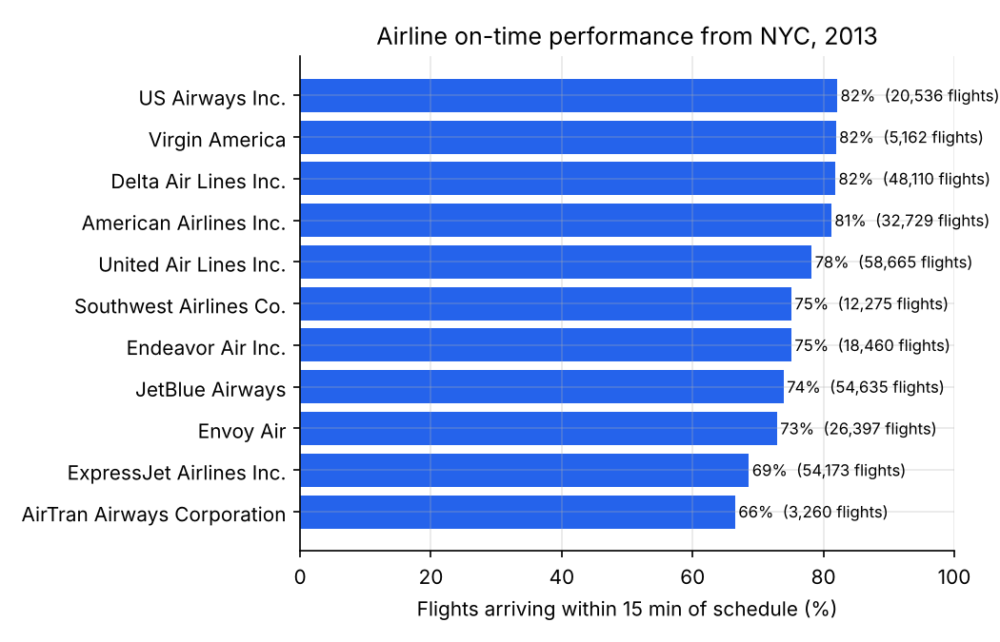

# NYC Flight Delays: SQL Analysis and Dashboard

Where and why do flights out of New York run late? This project answers ten business questions with SQL over all **336,776 departures from Newark (EWR), JFK and LaGuardia (LGA) in 2013**, joined to hourly weather, aircraft and airport tables. The results are packaged as an interactive Streamlit dashboard.

**Skills shown:** multi-table joins · CTEs · window functions (`RANK`, `LAG`, `ROW_NUMBER`, `NTILE`, windowed averages) · conditional aggregation · data-quality checks · mix-adjusted comparison · DuckDB · Streamlit/Plotly dashboard · tested queries



## Key findings and recommendations

1. **Delays snowball through the day.** Average departure delay rises from 2 minutes for 6 a.m. flights to 25 minutes by 7 p.m., and on-time rates fall from 89% to 66%. *Recommendation:* travellers and time-critical business trips should book morning departures; airlines can add schedule buffer to late-afternoon rotations.
2. **A late plane stays late.** When an aircraft's previous NYC departure that day left more than an hour late, 83% of its next departures are also 15+ minutes late, against 22% after an on-time departure. *Recommendation:* the cheapest place to cut delays is the first rotation of the day, using spare aircraft or crew to break the chain after a major delay.
3. **Newark's poor record is about its airlines, not the airport.** EWR has the lowest on-time rate (74.4% vs 77.0% at JFK). But 36% of its flights are ExpressJet, the second-least punctual airline. Once airline mix is accounted for, EWR performs within 0.3 points of what its airlines would predict.
4. **The worst routes are all regional.** Nine of the ten least punctual busy routes are ExpressJet regional flights out of Newark (Richmond, Washington National, Memphis, Milwaukee, and others), with only 60–65% on time.
5. **Weather explains the worst days.** On days of heavy rain or near-zero visibility, average delays reach 50–85 minutes and up to 22% of flights are cancelled. In heavy rain (0.1+ inch per hour), the average departure delay is 41 minutes, nearly four times the 11 minutes in dry conditions.

## The questions

Each question is one file in [`sql/`](sql/); results are saved in [`output/tables/`](output/tables/).

| # | Question | SQL techniques |
|---|---|---|
| 0 | Is the data fit for analysis? | `NOT EXISTS` orphan checks, duplicate-key check |
| 1 | How do the three airports compare? | aggregation, `quantile_cont` |
| 2 | Which airlines are most reliable? | CTE, `HAVING`, `RANK()`, share of total via `SUM() OVER ()` |
| 3 | How does punctuality change over the day? | grouping by hour |
| 4 | Which months are worst? | difference from year average with `AVG() OVER ()` |
| 5 | What happened on the 10 worst days? | two CTEs, join to daily weather, `ROW_NUMBER()` |
| 6 | How much do rain and fog matter? | join on (airport, hour), `CASE` bucketing, `UNION ALL` |
| 7 | Do delays snowball? | `LAG()` over each aircraft's day |
| 8 | Which busy routes are worst? | `mode()`, `NTILE()` quartiles |
| 9 | How much time is made up in the air? | bucketing by distance |
| 10 | Is Newark worse, or its airlines? | mix-adjusted expected rate |

### Example: tracking delays through an aircraft's day (Q7)

```sql
WITH sequenced AS (
    SELECT
        tailnum, flight_date, sched_dep_time, dep_delay,
        lag(dep_delay) OVER (
            PARTITION BY tailnum, flight_date
            ORDER BY sched_dep_time
        ) AS prev_dep_delay
    FROM flights_enriched
    WHERE tailnum IS NOT NULL AND NOT cancelled
)
SELECT
    CASE WHEN prev_dep_delay <= 0  THEN '1. on time or early'
         WHEN prev_dep_delay <= 15 THEN '2. 1-15 min late'
         WHEN prev_dep_delay <= 60 THEN '3. 16-60 min late'
         ELSE                           '4. > 60 min late' END AS previous_departure,
    count(*)                                   AS flights,
    round(100 * avg((dep_delay > 15)::INT), 1) AS pct_departing_15_plus_late
FROM sequenced
WHERE prev_dep_delay IS NOT NULL
GROUP BY 1 ORDER BY 1;
```



### Example: separating the airport from its airlines (Q10)

| Airport | ExpressJet share | Observed on-time | Expected from airline mix | Airport effect |
|---|---|---|---|---|
| EWR | 36.4% | 74.4% | 74.7% | −0.3 pts |
| JFK | 1.3% | 77.0% | 77.0% | 0.0 pts |
| LGA | 8.4% | 77.6% | 77.3% | +0.4 pts |

The expected rate is what each airport would score if every flight performed at its airline's NYC-wide average. *Caveat:* ExpressJet flies mostly from Newark, so its average is largely a Newark number. Airline and airport cannot be fully separated with one year of data from three airports.

## More results

<p>


</p>



| Worst days | Avg delay | Cancelled | Rain | Min. visibility |
|---|---|---|---|---|
| Fri 8 Mar | 84 min | 18% | 0.46 in | 0.5 mi |
| Mon 1 Jul | 56 min | 9% | 0.93 in | 0.5 mi |
| Mon 2 Sep | 53 min | 9% | 0.35 in | 0.3 mi |
| Thu 5 Dec | 52 min | 16% | 0.01 in | 0.0 mi |
| Thu 23 May | 51 min | 22% | 0.36 in | 0.3 mi |

## Data quality

Checked before any analysis ([Q0](output/tables/00_data_quality.md)):

- **8,255 flights (2.5%) have no departure time.** I treat them as cancelled, the standard reading of this data set.
- **1,175 flights departed but have no arrival delay**, most likely diverted. They are excluded from on-time rates but kept in departure statistics.
- **721 aircraft are missing from the planes table**, and 2,512 flights have no tail number. Aircraft-level analysis (Q7) uses only flights with a tail number.
- **One weather reading shows wind of 1,048 mph**, a sensor error. It is excluded from wind statistics.
- **1,556 flights have no matching hourly weather**; they drop out of the weather analysis (Q6) only.

## Limitations
- One year (2013) and departures only; arrivals into NYC are not in the data.
- Delay causes (carrier, air traffic control, weather, late aircraft) are not recorded, so causes are inferred from timing and weather.
- Q7 is associational: bad weather can delay both of a plane's flights at once, so not all of the persistence is knock-on delay.

## Reproduce

```bash
cd 03-nyc-flights-sql
pip install -r requirements.txt
python build_db.py        # builds flights.duckdb from data/raw (a few seconds)
python run_queries.py     # runs sql/*.sql, writes output/tables and output/figures
pytest -q tests           # 8 tests on row counts, joins and query logic
streamlit run app.py      # opens the dashboard
```

**Data:** [nycflights13](https://github.com/tidyverse/nycflights13) (CC0), compiled from the US Bureau of Transportation Statistics on-time database, the Iowa Environmental Mesonet (weather) and the FAA aircraft registry. The raw CSVs in `data/raw/` come from the [`nycflights13` Python package](https://pypi.org/project/nycflights13/).
