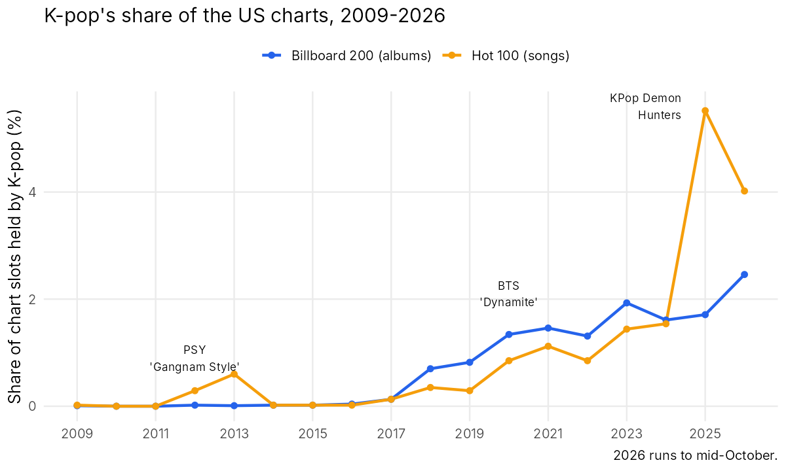
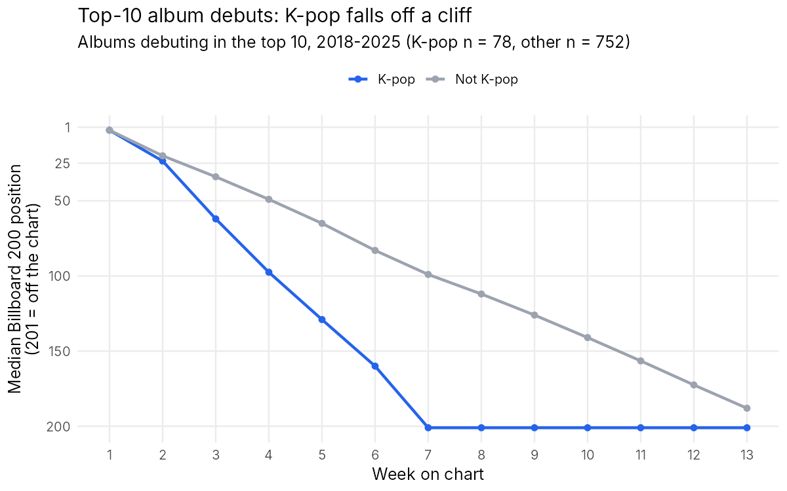
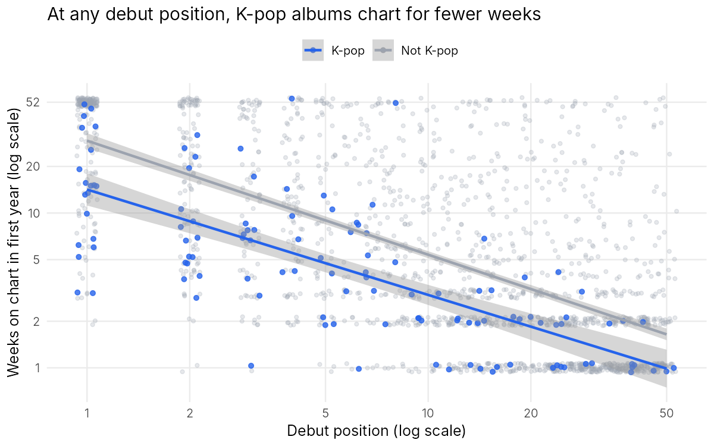
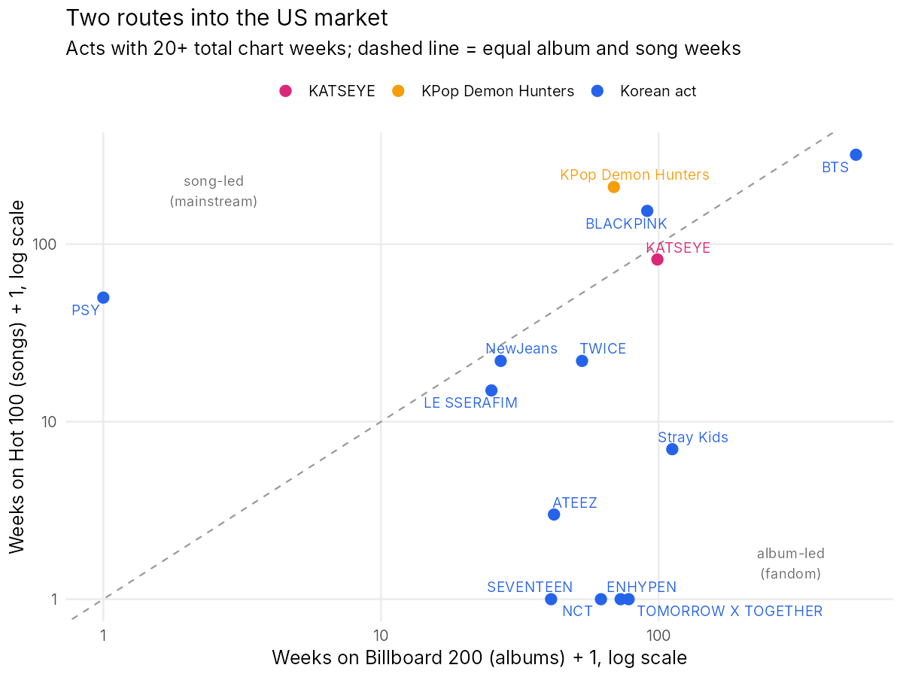

# K-pop in the US Market: Fandom Albums vs. Mainstream Hits

How big has K-pop become in the United States, and what kind of success is it? This project tracks every K-pop entry on the **Billboard Hot 100** (songs) and **Billboard 200** (albums) from 2009 to October 2026. It uses SQL to build the data and linear regression in R to test one business question: **do K-pop's chart-topping album debuts turn into lasting US demand?**

**Skills shown:** SQL data modelling (DuckDB: string splitting, `UNNEST`, CTEs, conditional aggregation, `arg_min`) · entity matching with a curated lookup table · linear regression with log transforms, fixed effects, interaction terms and robust standard errors · regression diagnostics · ggplot2 · turning results into a market-entry recommendation · tested pipeline (pytest) · Python + SQL + R in one workflow

## Key findings

1. **K-pop's US footprint has grown more than tenfold since 2017.** It held 0.1% of chart slots on both charts in 2017. By 2025 it held 5.5% of the Hot 100, driven by the *KPop Demon Hunters* soundtrack, and in 2026 so far it holds 2.5% of the Billboard 200.
2. **K-pop albums debut high but don't last.** Albums that debuted in the top 5 since 2018 spent a median of **8 weeks** on the chart in their first year if they were K-pop, against **23 weeks** for other albums. Holding debut position and year fixed, a K-pop album spends **45% fewer weeks** on the chart (95% CI: 37% to 53% fewer).
3. **The drop starts in week two.** After the same debut, a K-pop album's week-2 position is 46% further down the chart in relative terms (95% CI: 27% to 69%). This is the signature of a fan base that buys in release week, rather than a broad audience that keeps streaming.
4. **Most K-pop songs are one-week Hot 100 entries.** 59% of Korean acts' solo-credited Hot 100 songs charted for a single week. Collaborations with Western artists did not significantly extend chart runs once debut position is accounted for (+18%, 95% CI −12% to +57%).
5. **The acts that broke through did it with songs, not albums.** Stray Kids, TOMORROW X TOGETHER and ENHYPEN each have 70+ album-chart weeks and almost no Hot 100 presence. *KPop Demon Hunters* (209 Hot 100 weeks, a #1 with "Golden"), BLACKPINK and the US-based group KATSEYE built their US presence through songs.



## Recommendation for a label planning a US push

**Count week-2 retention and Hot 100 weeks as success, not the #1 album debut.** A fandom can deliver a #1 debut, as 20 K-pop albums did between 2018 and 2025, but it does not build a US audience. The routes that worked are song-first: media IP (the *KPop Demon Hunters* film), US-based group formats (KATSEYE), and members' solo pop singles. A US launch plan should budget for radio and streaming promotion of a lead single after release week, and judge results on weeks 2–8 rather than week 1.

## Data

- **Charts:** weekly Billboard Hot 100 (Aug 1958 – Oct 17, 2026) and Billboard 200 (1967 – Oct 17, 2026), as compiled by the [UT Austin "Reporting with Data" project](https://github.com/utdata/rwd-billboard-data). Snapshots are stored in `data/raw/` as Parquet ([provenance](data/README.md)).
- **Who counts as K-pop:** [`data/kpop_artists.csv`](data/kpop_artists.csv), a hand-curated list of 64 credited names mapped to 35 act families (e.g. Jung Kook → BTS). Acts fall into three segments:
  - **Korean act:** groups and soloists from Korean agencies.
  - **KATSEYE:** a K-pop-style group formed in the US by HYBE and Geffen.
  - **KPop Demon Hunters:** the 2025 Netflix animated film's soundtrack, whose fictional groups HUNTR/X and Saja Boys are voiced by Korean-American and Korean singers.

### How the SQL builds the data ([`sql/`](sql/))

1. **Split each performer credit into names.** For example, "Charlie Puth Featuring Jung Kook" becomes two names, using `string_split_regex` on separators such as "Featuring", "&", "x" and commas, then `UNNEST`. "TOMORROW X TOGETHER" is renamed before splitting so its own " X " is not treated as a separator.
2. **Match each name to the artist list**, but only after the artist's start date. This stops the 1950s singer Dean or the 2004 rapper Jin from being counted as K-pop.
3. **Tag each credit** as K-pop or not, with its segment and whether it also names a non-K-pop artist (a Western collaboration).
4. **Build the analysis tables:** yearly chart share, album outcomes, week-by-week album positions, K-pop songs, and album-vs-song weeks by act.

The tagging is unit-tested on tricky credits (`tests/test_build.py`), for example that "Bobby V" and "Dei V" are not mistaken for BTS's V.

## The regression models ([`analysis.R`](analysis.R))

**Sample:** 1,834 albums that debuted in the Billboard 200 top 50 between January 2018 and October 2025, so each has a full year of follow-up. 120 of them are K-pop.

**Model 1. Album longevity:**

`log(weeks on chart in first year) = β0 + β1·K-pop + β2·log(debut position) + year fixed effects`

- The outcome is logged because chart runs are right-skewed. So `exp(β1) − 1` reads as the percentage difference in weeks.
- Debut position is logged because the gap between #1 and #5 matters more than the gap between #41 and #45.
- Debut-year fixed effects absorb Billboard rule changes, such as the 2020 merchandise-bundle rules.
- Standard errors are heteroskedasticity-robust (HC3).

| Model | Term | Estimate | % effect | 95% CI | p |
|---|---|---|---|---|---|
| 1. log(weeks in first year) | K-pop | −0.606 | **−45%** | −53% to −37% | < 0.001 |
| | log(debut position) | −0.735 | a debut twice as low: about 40% fewer weeks | | < 0.001 |
| 2. + interaction | K-pop × log(debut position) | 0.073 | | | 0.19 |
| 3. log(week-2 pos / debut pos) | K-pop | 0.381 | **+46% further fall** | +27% to +69% | < 0.001 |
| 4. log(weeks on Hot 100), Korean acts' songs | Western collaboration | 0.162 | +18% | −12% to +57% | 0.27 |

R² is 0.41 for model 1. Model 2's interaction is not significant, so the K-pop gap is roughly the same at every debut position.





**Diagnostics.** The smoothed residual trend for model 1 stays close to zero, so the log-log form fits ([plot](output/figures/model1_diagnostics.png)). The residuals fall in diagonal bands and the Q-Q plot has a short lower tail, because the outcome is a whole number of weeks between 1 and 52. That is why the CIs use robust standard errors, and why the key result is also checked with the simple top-5 comparison in the findings, which needs no model.

## Two routes into the US market



| Act | Album-chart weeks | Hot 100 weeks | Best album | Best song |
|---|---|---|---|---|
| BTS | 513 | 318 | #1 | #1 |
| KPop Demon Hunters | 68 | 209 | #1 | #1 |
| BLACKPINK (incl. members) | 90 | 153 | #1 | #3 |
| Stray Kids | 111 | 6 | #1 | #38 |
| KATSEYE | 98 | 81 | #1 | #21 |
| TOMORROW X TOGETHER | 77 | 0 | #1 | – |
| ENHYPEN | 72 | 0 | #1 | – |
| PSY | 0 | 49 | – | #2 |

## Limitations

- **Chart weeks are not sales or streams.** Billboard does not publish the units behind positions in this data, so "longevity" is measured in chart weeks.
- **The artist list is curated by hand.** It covers every K-pop act found on these charts, but a missed act would be counted as non-K-pop. Each credit variant (e.g. "HUNTR/X" vs "HUNTRX") is treated as a separate song entry.
- **Associations, not causes.** K-pop albums may differ from other albums in ways the model does not capture, such as genre, release strategy or the number of album versions sold.
- **Model 4 is small** (127 songs), so a modest collaboration effect cannot be ruled out.

## Reproduce

```bash
cd 04-kpop-us-market
pip install -r requirements.txt
python build.py           # SQL: builds data/processed/*.csv from data/raw
Rscript analysis.R        # R: regression models, tables and figures
pytest -q tests           # 17 tests on credit tagging and table logic
```

R packages: `dplyr`, `ggplot2`, `ggrepel`, `scales`, `sandwich`, `lmtest`, `knitr`.

A Chinese walk-through of every step and how to explain it in an interview is in [GUIDE_zh.md](GUIDE_zh.md).
