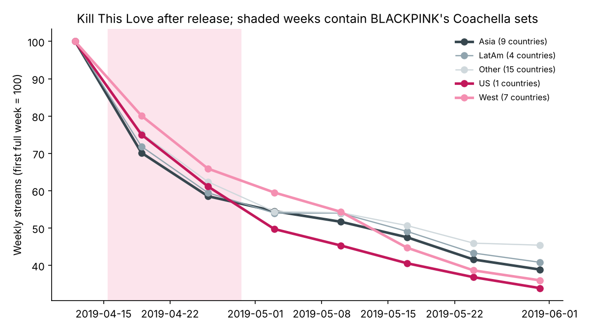
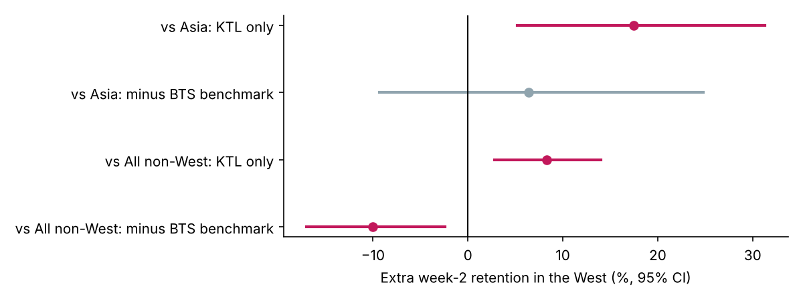

# Did Coachella Grow BLACKPINK's Western Audience?

In April 2019 BLACKPINK became the first K-pop girl group to play Coachella. Media coverage called it a breakthrough for K-pop in the US. This project asks whether the streaming data backs that up: **after Coachella, did listeners in the US and other Western countries stay with BLACKPINK longer than listeners elsewhere?**

**Skills shown:** event study design · difference-in-differences and a triple difference with a benchmark song · robust standard errors · handling truncated chart data · checking a result's sensitivity to the choice of control group · pandas + statsmodels · tested pipeline (pytest, CI)

## Key findings

1. **A naive comparison shows a large effect.** In the week of Coachella's first weekend, Kill This Love kept 17.5% more of its listeners in Western countries than in Asian countries, relative to its first full week (95% CI: 5% to 31%, p = 0.004).
2. **But Western listeners drop off more slowly in general.** BTS's "Boy With Luv" came out a week later, with no Coachella. It also kept more listeners in the West than in Asia in its second week. After subtracting this benchmark, the West's extra retention for Kill This Love falls to **+6.4% (95% CI: −9% to +25%)**, which is not distinguishable from zero.
3. **The answer depends on the control group.** Against all non-Western countries, the same benchmark-adjusted estimate is **−10%** (95% CI: −17% to −2%). An estimate that flips sign when the control group changes is not a robust effect.
4. **Any boost was short.** By the end of May, Kill This Love's US streams were at 34% of their first full week, lower than in Asia (39%).
5. **Coachella did not pull Western listeners back to older songs.** None of BLACKPINK's pre-2019 songs entered the top 200 in any country outside Asia during 2019.





## So what?

**One high-profile performance is hard to see in streaming data, and a naive before/after comparison would have overstated it.** For a label deciding whether a festival slot is worth the cost, these numbers argue for measuring it against a benchmark release in the same weeks, and for counting retention in weeks 2 to 8 rather than the week-of spike. This matches project [04](../04-kpop-us-market/), which found that K-pop albums debut high on the Billboard 200 but lose ground from week two.

## Design

- **Event:** BLACKPINK played Coachella on Friday 12 and Friday 19 April 2019 (late evening, Pacific time). With weeks labelled by their last day, the sets fall in the weeks ending 04-19 and 04-26.
- **Confound:** Kill This Love was released on 5 April, one week before Coachella. Time alone cannot separate the two. Instead the design uses geography: the release was global, while Coachella exposure was concentrated in the US and other Western countries.
- **Outcome:** for each country, `log(streams in full week 2 / streams in full week 1)`. Coefficients are converted to percentages with `exp(b) − 1`.
- **Naive model:** `log_ret ~ west`, Kill This Love only.
- **Triple difference:** `log_ret ~ west * ktl`, stacking Kill This Love with BTS "Boy With Luv". The `west:ktl` term is the West's extra retention for Kill This Love beyond what the West shows for a comparable K-pop single with no Coachella.
- **Standard errors:** heteroskedasticity-robust (HC1).
- **Truncation:** only top-200 entries are recorded. The decay chart uses only countries where the song charted in all 8 weeks.

## Limitations

- The BTS benchmark is not clean either. BTS performed on *Saturday Night Live* on 13 April, inside its first full week. That raises its US week-1 baseline. The US is one country here, so most of the weight is on the other Western markets.
- Weekly data is coarse. Daily data (kworb.net, Google Trends, YouTube views) would show a festival spike more clearly. Those sources were not reachable from the environment this was built in.
- Only one benchmark song. More K-pop releases from spring 2019 would give a better estimate of normal regional decay.

## Reproduce

```bash
cd 05-blackpink-coachella
pip install -r requirements.txt
pytest -q tests
python run_all.py   # writes output/tables and output/figures
```

A Chinese walk-through is in [GUIDE_zh.md](GUIDE_zh.md).
